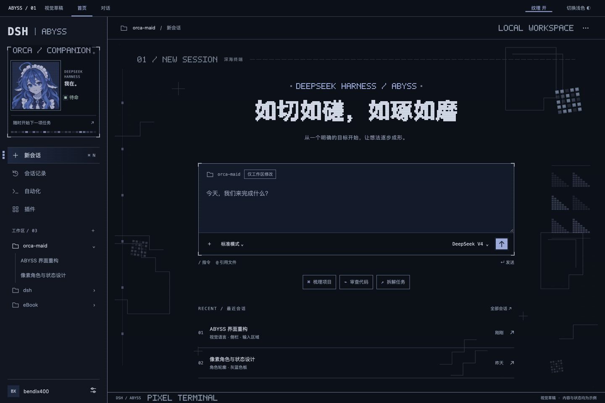
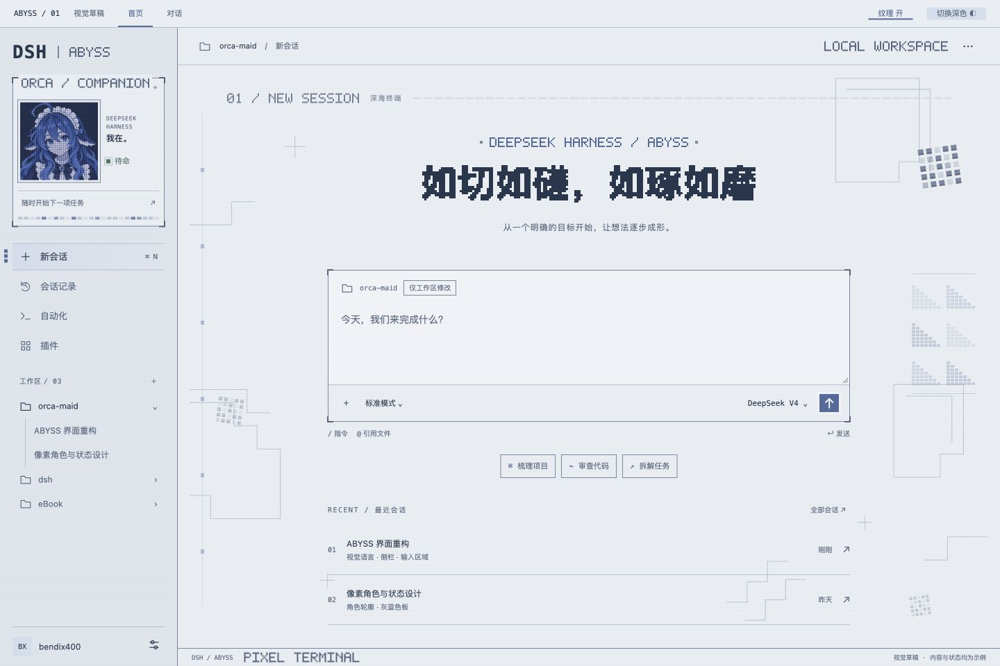

# ABYSS · 深海终端

DeepSeek Harness 的灰蓝像素皮肤：像素鲸鱼娘、终端边框，以及安静的几何背景。



<details>
<summary>查看浅色预览</summary>



</details>

*以上为设计稿预览，实际界面随 DSH 版本与设置略有差异。*

- 左上角像素角色显示当前会话状态，执行任务时心跳线跳动。
- 首页保留「如切如磋，如琢如磨」，搭配点阵标题与灰蓝深浅配色。
- 自带外观设置，可调整角色、背景、纹理、心跳和输入框行为。

## 安装

```sh
dsh plugin --profile desktop add @bendix400/dsh-client-ui-skin-orca-maid
```

在 DSH 内置插件管理中启用，启用前关闭其他皮肤。**无需旧皮肤管理器。**
ABYSS 沿用原 ORCA MAID 的 npm 包名，已在 macOS 的 DSH **0.2.1-rc.5** 验证。

## 使用

点击侧栏底部 `▦` 打开 **ABYSS 外观设置**。设置在本机保存、即时生效；「恢复默认」可重置。

从旧版升级后使用 ABYSS 默认设置，不自动迁移旧管理器配置。升级后请重启 DSH，刷新素材清单。

ABYSS 是唯一持续维护版本；旧版 `0.1.2` 保留下载，不再更新。需要旧外观时可安装：

```sh
dsh plugin --profile desktop add @bendix400/dsh-client-ui-skin-orca-maid@0.1.2
```

旧版仍需遵循当时的管理器依赖。开发、构建与发布说明见[维护文档](https://github.com/Liuxiang400/dsh-skin-abyss/blob/main/docs/MAINTAINING.md)。

## 许可

- **代码**：MIT。派生自 ORCA LINK（`Small-tailqwq/dsh-deep-whale` @ 42ecc2a），
  上游共享代码按字节内联于 `src/vendor/`，许可正文见 [LICENSE](LICENSE)。
- **美术**：CC BY-NC-SA 4.0 —— **禁止商业使用**，衍生作品须以相同方式共享。
- 完整署名链见 [NOTICE](NOTICE)：上善无形「溟月」→ ZipZipPipe 女仆装鲸鱼娘 → bendix400。
